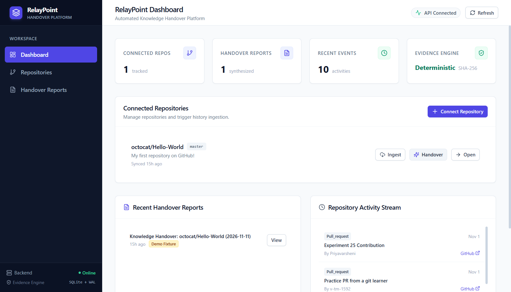
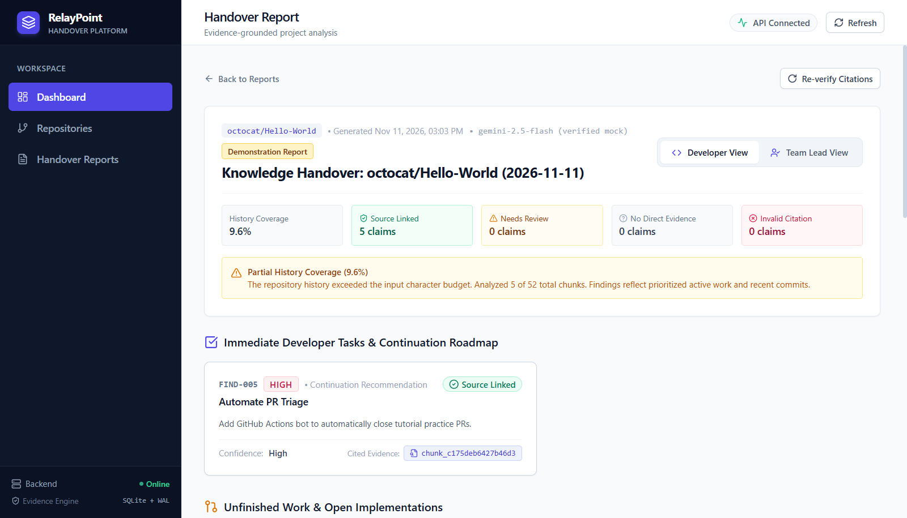
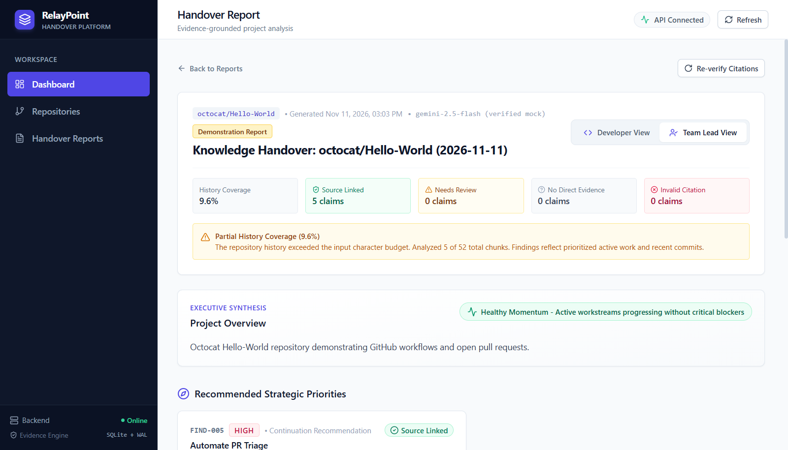
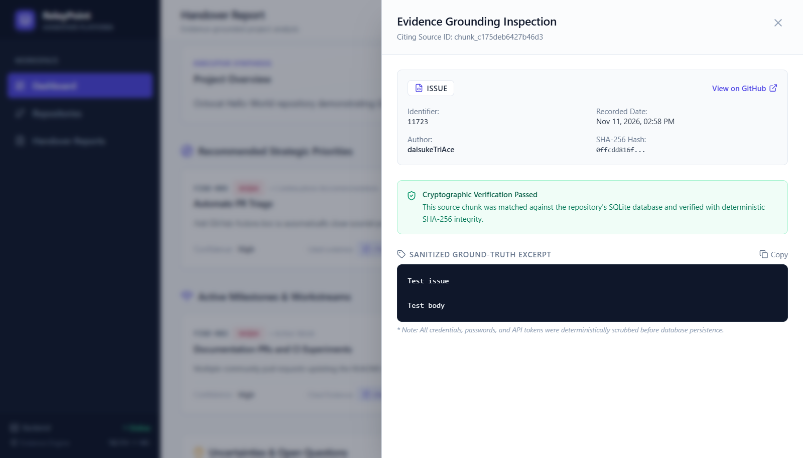

# RelayPoint — 3 to 5 Minute Product Demonstration Script

> **Demonstration Mode Notice**: This demonstration script walks through the platform's core capabilities using the verified open-source demonstration dataset (`octocat/Hello-World`). All evidence linking, SHA-256 cryptographic verification, role-based views, and sanitization are fully functional live in the local environment.

---

## 1. Project Overview & Problem Statement (0:00 – 0:45)

### Spoken Brief:
> *"When engineers take over an unfamiliar codebase, change teams, or onboard to a project, the handover process is fragmented. Important architectural decisions, unmerged workstreams, and active technical debt are scattered across git commits, pull requests, and closed issues. Stale documentation doesn't reflect real progress, and traditional AI summaries frequently hallucinate non-existent files.
>
> RelayPoint automates project knowledge handovers through evidence-grounded synthesis. Every architectural insight, unfinished task, and strategic risk is tied directly to cryptographically hashed, immutable Git commits, PRs, and issues—so you can trust what you read."*

---

## 2. Platform Architecture & Dashboard (0:45 – 1:30)

### Action:
1. Open browser to `http://localhost:5173`.
2. View the RelayPoint Dashboard.

### Walkthrough Points:
- **System Metrics Bar**: Shows 1 Connected Repository, 1 Synthesized Handover Report, 10 Recent Activities, and the Deterministic SHA-256 Evidence Engine status.
- **Connected Repositories Card**: Displays connected repository `octocat/Hello-World` with branch, sync status, and direct triggers for `Ingest` and `Handover`.
- **Repository Activity Stream**: Displays normalized chronologically ordered commits and pull requests with author names and direct links to GitHub.
- **Recent Reports Card**: Shows the synthesized handover report clearly badged with the **Demo Fixture** indicator.

---

## 3. Handover Report: Developer View (1:30 – 2:30)

### Action:
1. Click **View** on the handover report `Knowledge Handover: octocat/Hello-World (2026-11-11)`.
2. Notice the **Demonstration Report** badge and the header showing model `gemini-2.5-flash (verified mock)`.
3. Notice the **History Coverage (9.6%)** and **5 Source Linked Claims**.

### Walkthrough Points:
- **Role Toggle**: Instant zero-latency switching between **Developer View** and **Team Lead View**.
- **Immediate Continuation Tasks**: Actionable tasks (e.g. `FIND-005: Automate PR Triage`) prioritizing high-impact open items.
- **Unfinished Work & Open Implementations**: Highlights unmerged contributor PRs (`FIND-003`).
- **Active Development Workstreams**: Synthesizes active community experiments (`FIND-002`).
- **Architecture & Design Decisions**: Documents foundational repository intent (`FIND-001`).
- **Evidence Appendix**: Lists all 5 ground-truth artifacts with their commit SHAs, PR numbers, and issue descriptions.

---

## 4. Handover Report: Team Lead View (2:30 – 3:15)

### Action:
1. Click the **Team Lead View** button at the top right of the report.

### Walkthrough Points:
- **Executive Synthesis & Project Health**: High-level health diagnosis (*"Healthy Momentum - Active workstreams progressing without critical blockers"*).
- **Recommended Strategic Priorities**: Guides resource allocation and next steps for team leadership.
- **Active Milestones & Workstreams**: Tracks high-level velocity across multiple contributors.
- **Uncertainties & Open Questions**: Explicitly surfaces ambiguities (e.g. undocumented maintainer merge policies) rather than inventing unverified assumptions.
- **History Coverage Metrics**: Transparently displays budget accounting (52 total ingested chunks, 5 prioritized chunks analyzed under budget constraints).

---

## 5. Evidence Grounding & Cryptographic Re-Verification (3:15 – 4:00)

### Action:
1. Click on the cited evidence pill `chunk_c175deb6427b46d3` on finding `FIND-005`.
2. The **Evidence Grounding Inspection Drawer** slides out from the right.
3. Click the **Re-verify Citations** button in the top navigation bar.

### Walkthrough Points:
- **Exact Citation Mapping**: The drawer reveals the raw chunk ID, external issue number (`#11723`), author (`daisukeTriAce`), and GitHub URL.
- **Deterministic SHA-256 Hash**: Shows the cryptographic content hash (`0ffcdd816f...`).
- **Verification Status**: Displays *"Cryptographic Verification Passed — Matched against SQLite database with deterministic SHA-256 integrity"*.
- **Sanitized Excerpt**: Displays the verbatim source content, with a clear guarantee that passwords and tokens were scrubbed before storage.
- **Live Re-verification**: Clicking *Re-verify Citations* invokes `POST /api/reports/{id}/verify` on the backend, recalculating chunk hashes against stored records and updating verification badges in real time.

---

## 6. Summary & Key Differentiators (4:00 – 4:30)

| Traditional AI Summaries | RelayPoint Automated Handovers |
| :--- | :--- |
| Untracked, hallucinated file references | **Every claim is cited to an immutable Git commit or PR** |
| Sensitive tokens and credentials leaked into LLM prompts | **Pre-ingestion regex sanitization scrubs all secrets** |
| One generic wall of text for everyone | **Tailored Developer vs. Team Lead role perspectives** |
| Unverified output claims | **Deterministic SHA-256 hash checking and temporal verification** |
| Single point of failure if AI fails | **Full graceful degradation; clear status reporting** |

---

## 7. Known Operational Limitations
- **Localhost Single-User Restriction**: RelayPoint binds to `127.0.0.1` and does not include multi-user RBAC. It is built for local evaluation and demonstration.
- **Live Gemini Availability Disclosure**: Live upstream Gemini 3.8 Flash calls encountered HTTP 503 (Service Unavailable) during live testing. The application runs with 78/78 passing offline unit tests and uses verified demonstration data for live walkthroughs.
